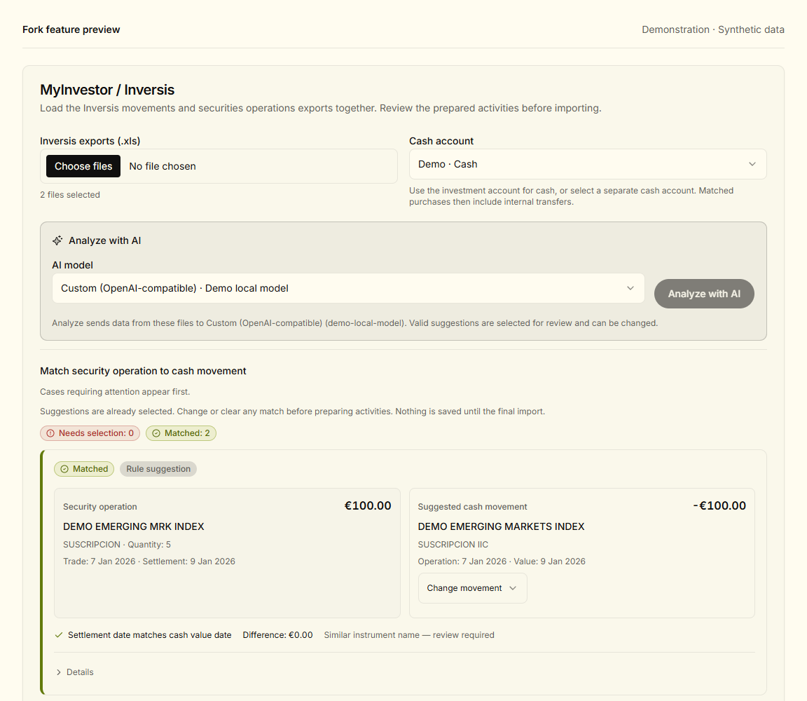
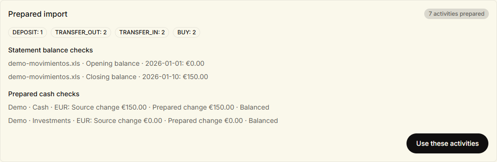
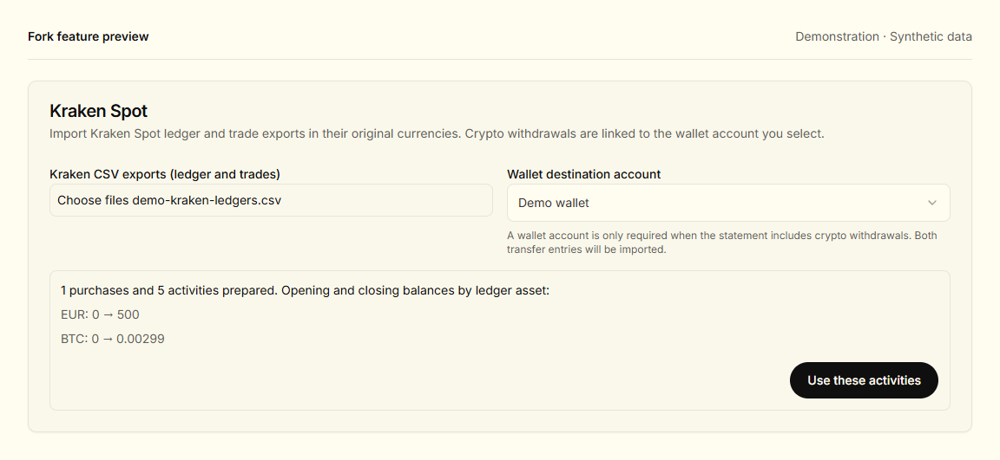
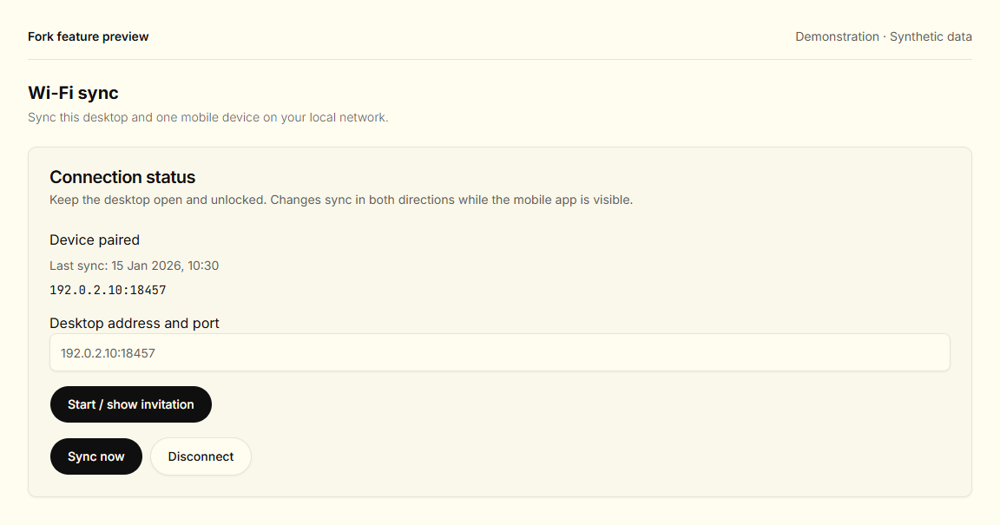

# Personal finance fork based on Wealthfolio

An independent fork of
[Wealthfolio](https://github.com/wealthfolio/wealthfolio), adding local Wi-Fi
device sync, statement importers and a configurable OpenAI-compatible AI
provider. It is not an official Wealthfolio distribution.

The original project provides portfolio tracking, performance, net worth,
spending, goals and the underlying accounting engine. This fork builds on those
features rather than replacing them.

[Fork guide](docs/fork-guide.md) ·
[Preserved original README](README.upstream.md) ·
[Upstream project](https://github.com/wealthfolio/wealthfolio) ·
[Official documentation](https://wealthfolio.app/docs)

## What this fork adds

| Feature               | What it does                                                                                                                                             |
| --------------------- | -------------------------------------------------------------------------------------------------------------------------------------------------------- |
| Local Wi-Fi sync      | Pair desktop and mobile profiles using a QR invitation, exchange encrypted changes in both directions and keep offline changes queued for the next sync. |
| MyInvestor / Inversis | Import Inversis XLS exports together, match security operations to cash movements and fund purchases through Wealthfolio's internal transfers.           |
| Optional AI matching  | Ask the selected model to suggest remaining Inversis associations, then review or correct the preselected matches before importing.                      |
| Santander pensions    | Read quarterly pension-plan PDFs locally, including OCR, and import contributions and units without debiting a bank account.                             |
| Kraken spot           | Import ledgers with optional trades, preserve transaction currencies, transfer crypto to an owned wallet and record fees paid in crypto.                 |
| Custom AI provider    | Connect an OpenAI-compatible endpoint, including a local Strata server, through the app's existing AI settings and secret storage.                       |

Importers prepare activities for the existing asset review, activity review and
duplicate checks. Wealthfolio handles valuation, exchange rates and cost basis.
See the [supported formats and limits](docs/fork-guide.md).

## Getting started

Use builds from this fork on desktop and Android for Wi-Fi sync; the official
store app does not implement this fork's LAN protocol.

The current local preview workflow places compiled files in
`target/lan-preview/`:

- `Wealthfolio-PC.exe` — Windows desktop preview.
- `Wealthfolio-LAN.apk` — Android ARM64 preview.
- `SHA256SUMS.txt` — package integrity checks.
- `anterior/` — the previous local packages.

These are local build outputs, not files shipped by cloning this repository. The
Android preview uses `com.teymz.wealthfolio.lan`; the current desktop preview
uses the development application identity. Keep using the same identity to
access the same profiles.

**Updates:** the configured desktop updater points to official Wealthfolio
releases. Installing one can replace this fork's functionality. Update these
previews with packages built from this fork instead.

For account setup and import steps, see the [fork guide](docs/fork-guide.md).
For pairing, see
[Local Wi-Fi device sync](docs/architecture/lan-device-sync.md).

## Screenshots

Real app components rendered with synthetic statements and demonstration
accounts in the default light theme. No personal portfolio, provider credentials
or usable pairing invitation is shown. See the
[capture notes](docs/images/fork/README.md) for scope and verification.

**Inversis matching and AI model selection.** Compare dates, amounts and fund
names, and change preselected associations before importing. This example shows
a rule suggestion; no AI request was made.



**Prepared activities and cash reconciliation.**

Seven demo activities: a deposit, two purchases and their internal funding
transfers. Both cash checks reconcile before continuing to review.



**Kraken spot and owned-wallet transfers.**

A synthetic ledger prepares a deposit, purchase, wallet transfer pair and fee
paid in BTC, while preserving the source balances.



**Local Wi-Fi sync.**

The real settings component displaying a simulated paired desktop. The address
is reserved for documentation; no listener or pairing invitation was created.



For the original app overview, see the
[upstream README](README.upstream.md#introduction).

## Development and upstream

Use the Node version in [`.node-version`](.node-version), pnpm version in
[`package.json`](package.json) and Rust toolchain in
[`rust-toolchain.toml`](rust-toolchain.toml).

```sh
git clone https://github.com/rainier-brioso/wealthfolio.git
cd wealthfolio
pnpm install --frozen-lockfile
pnpm build:types
pnpm tauri dev
```

Native dependencies and environment setup are described in the
[preserved build instructions](README.upstream.md#getting-started). See also
[frontend tooling](docs/frontend-tooling.md),
[Android testing](docs/android-testing.md) and
[contribution guidelines](CONTRIBUTING.md).

[`README.upstream.md`](README.upstream.md) preserves the README from this
checkout before the fork-specific rewrite. Its last modifying commit was
[`521029e205381970149e49fbef7bdc4c3776b9b0`](https://github.com/rainier-brioso/wealthfolio/commit/521029e205381970149e49fbef7bdc4c3776b9b0).
It is a historical reference: official download and service links refer to the
original project, not this fork. It does not imply that the fork is at the
latest upstream revision.

## Credits and license

Thanks to the
[Wealthfolio authors and contributors](https://github.com/wealthfolio/wealthfolio)
for the application and its accounting, import and extension infrastructure.

The code remains under [AGPL-3.0](LICENSE). Existing copyright notices and
upstream credits are retained. Wealthfolio and its logo are trademarks of Teymz
Inc.; see [TRADEMARKS.md](TRADEMARKS.md). This fork is independently maintained
and is not endorsed by the original project.
